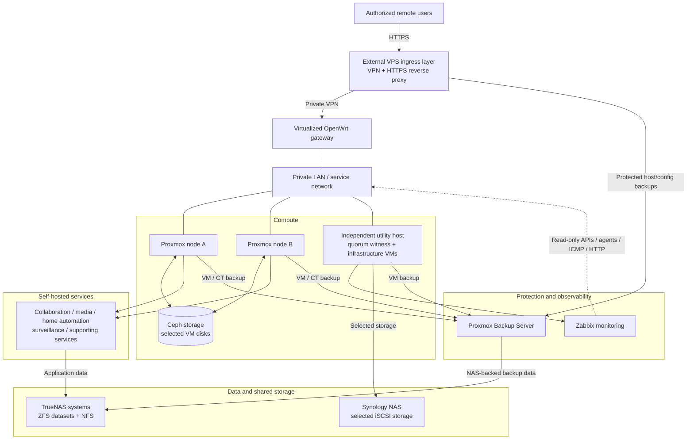
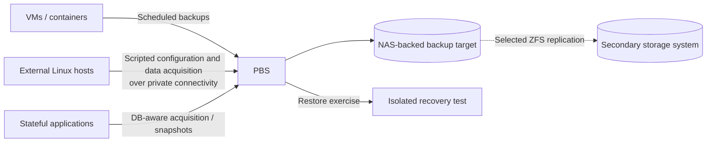

# Home Lab — Architecture Overview

**Document type:** Public technical architecture overview  
**Revision:** 1.0 · November 2026  
**Audience:** Infrastructure engineers, data protection practitioners, and technical reviewers  
**Scope:** Functional architecture, design decisions, boundaries, and operational maturity

> **Sanitization notice:** This is a deliberately abstracted view of a real private environment. All host labels are generic role names; diagrams do not disclose real network topology, locations, addresses, domains, user accounts, credentials, or access routes. Product names are included for technical clarity.

## 1. Executive summary

This Home Lab is a compact, multi-service infrastructure built around open virtualization and storage technologies. It hosts personal and family services, but its engineering goals extend beyond application hosting: the environment is a practical exercise in **fault domains, data protection, recovery planning, infrastructure operations, and architectural trade-offs**.

The design combines:

- A two-node **Proxmox VE** compute cluster with a separate quorum witness.
- **Ceph** distributed storage for selected clustered VM disks.
- A separate utility virtualization host for infrastructure services.
- Multiple **TrueNAS / ZFS** systems for datasets, NAS protocols, snapshots, and selective replication.
- A **Synology** system providing selected shared-storage functions through iSCSI.
- **Proxmox Backup Server (PBS)** as the principal backup management platform.
- An **OpenWrt** virtualized gateway and private VPN connectivity to external VPS ingress points.
- **Zabbix**, security controls, and service-specific HTTP checks for observability.

The environment is *operational* rather than a claim of fully validated high availability or disaster recovery. The remaining validation work is listed explicitly.

## 2. Design objectives and constraints

| Objective | Engineering approach | Constraint or trade-off |
|---|---|---|
| Consolidate workloads | Proxmox VM and container workloads | Shared physical resources and maintenance windows |
| Reduce single-host dependencies | Clustered compute and external quorum | Two compute nodes do not eliminate every failure mode |
| Choose storage per workload | Ceph, ZFS/NFS, and iSCSI where appropriate | Additional protocols increase dependency mapping |
| Protect important data | PBS, application-aware acquisition, snapshots, selective replication | Retention and backup copies require independent restore validation |
| Provide remote access | Outbound private tunnels and restricted reverse proxies | VPS, tunnel, DNS, and proxy are operational dependencies |
| Make failures visible | Agent, API, ICMP, HTTP, and storage checks | A green device check does not guarantee application health |
| Minimize recurring expense | Reused/modest hardware and open-source software | Limited network bandwidth, capacity, power, and administrative time |

**Guiding principle:** Prefer understandable and testable recovery paths over architectural complexity added for its own sake.

## 3. Logical architecture

*Diagram is a role-based illustration, not a deployable network blueprint. Component placement is simplified to communicate responsibilities; it does not imply that all application workloads run on both cluster members.*

### 3.1 Compute and quorum

The main Proxmox cluster has **two compute nodes** and uses an **external quorum witness** on a separate host. The design permits cluster quorum management without a third full-size compute node. The witness is deliberately treated as a coordination role, **not** a substitute for a third independent storage failure domain.

A separate utility virtualization host runs infrastructure workloads, including the gateway and monitoring. This makes the utility host an important dependency; it must be included in maintenance and recovery planning.

### 3.2 Cluster storage: Ceph

Ceph is used for selected VM disks in the compute cluster, supplying a distributed storage layer integrated with Proxmox. It is a conscious compromise on modest hardware and limited networking capacity, not a claim of enterprise-grade Ceph performance or fault tolerance.

Operational considerations include:

- OSD/MON health, placement-group state, pool utilization, and recovery traffic.
- Networking throughput and its impact on recovery and latency.
- A two-data-node failure-domain design and the effects of degraded replication.
- Clear separation between **Ceph VM-disk storage** and **TrueNAS application datasets**.

**Important:** Quorum, successful I/O, and application-level failover are different properties. Automatic service availability must not be assumed merely because a cluster and shared storage exist.

### 3.3 NAS and ZFS

TrueNAS systems provide storage pools and datasets for application data, media, and backup targets. ZFS offers snapshots, integrity checking, and selective replication capabilities; NFS exposes relevant datasets to consumers.

The Synology NAS fulfills specific functions including iSCSI-backed storage for selected workloads on the independent utility host. This is a different storage plane from the Ceph cluster.

NAS operations introduce explicit dependencies: workload availability may depend on a particular NAS, storage pool, protocol session, and network path. In particular, a NAS restart or transient NFS outage can disrupt clients; recovery behavior is documented as a runbook concern rather than assumed transparent.

### 3.4 Network and remote-access boundary

The private gateway is based on OpenWrt. Authorized external traffic reaches selected applications through VPN-connected Linux VPS ingress instances and an HTTPS reverse proxy (Caddy). Internal and public name resolution serve their own purposes; administrative interfaces are not intentionally published as general internet services.

The boundary is designed around limiting exposed application surfaces and avoiding direct public exposure of core management protocols. Provider connectivity, certificates, name resolution, and VPN routing remain separate health checks and recovery dependencies.

**Local name-resolution resilience is now in partial configuration.** A DNS service on the existing NAS has been installed, with external queries deliberately forwarded only through the main gateway. A separately held local zone is not yet populated or synchronized, and no second DNS has been distributed to clients. The project must validate domain-based VPN policy routing and DNS caching interactions before doing so. DHCP redundancy is a future design, not a deployed HA service. The gateway remains a critical router and storage/startup dependency; an alternate DNS resolver alone cannot restore connectivity. See the [public design note](local-dns-resilience.md).

## 4. Service placement and purpose

| Service / category | Function | Operational dependency |
|---|---|---|
| Nextcloud and Talk | Private collaboration, files, communication | Guest, database, data storage, proxy for remote access |
| ONLYOFFICE | Document editing and collaboration | Application service, compatible HTTPS endpoint, Nextcloud integration |
| Plex | Media library and playback | Media datasets, application database, transcoding resources |
| Frigate | Video event detection and recording | Camera feeds, message broker, recording storage, runtime health |
| Home Assistant | Home automation | Automation host and connected devices/integrations |
| FileBrowser and synchronization tools | File administration and synchronization | Relevant mounted datasets and storage connectivity |
| OpenWrt | LAN routing and private-network functions | Utility host, uplink, DNS, and VPN links |
| Zabbix | Infrastructure and application monitoring | Monitoring VM, database, network reachability |
| PBS | VM/container and host backup management | Backup storage target, schedules, retention, credentials |

**Workload health must be checked at multiple layers.** An alive VM is not proof that an application, data mount, database, or external access path is healthy.

## 5. Data protection and recovery architecture

### 5.1 Protection layers

The project deliberately distinguishes four mechanisms that are often conflated:

1. **Ceph redundancy:** helps sustain storage operation under certain faults; it is not a backup.
2. **ZFS snapshots:** provide local point-in-time recovery opportunities; they share the storage system's failure domain unless replicated.
3. **Replication:** places selected datasets on other storage; it can also propagate corruption or accidental deletion depending on policy.
4. **PBS backups:** store recoverable versions of VM, container, and selected host/application state with retention and verification workflows.

For stateful applications, acquisition may include an application-consistent database operation in addition to VM or filesystem-level protection. The specific sequence is selected for each workload and must be validated by restoring it.

### 5.2 Protection flows

These arrows describe the intended data-protection roles; they do not assert that every source or recovery test has been completed.

### 5.3 Recovery validation

Successful backup jobs and archive integrity checks are useful evidence but **not equivalent to an end-to-end restore**. The recovery plan includes:

- Restore of a representative application VM with associated database and data dependencies.
- Restore of a Linux VPS configuration and containerized services to an isolated target.
- Verification of backup data after a secondary storage failure or replica promotion.
- Recorded recovery time, integrity checks, service smoke tests, and dependency order.

The portfolio will publish verified outcomes only after the exercises have been executed and reviewed.

## 6. Security architecture

The design relies on layered controls rather than a single internet-facing security appliance:

- **Private administration:** management APIs and storage interfaces are intended for trusted networks.
- **Selective exposure:** public HTTPS ingress is terminated at a controlled reverse-proxy layer.
- **Private transport:** VPN connectivity connects ingress hosts to private services.
- **Least privilege:** dedicated monitoring and backup identities/tokens are scoped to required access.
- **Host controls:** firewall rules, log collection, and CrowdSec detections protect selected Linux hosts.
- **Certificate management:** HTTPS certificates and renewals are maintained for published applications.
- **Recovery protection:** backup material and operational credentials are handled separately from public documentation.

This document does not publish firewall rules, VPN topology, keys, device access methods, or incident-response commands tied to a real environment.

## 7. Monitoring and alerting

The central monitoring platform is **Zabbix 7.0 LTS** on a dedicated Linux virtual machine with PostgreSQL and Nginx. The monitoring strategy starts with basic reachability and expands to API/agent-driven metrics and application-specific checks.

| Monitoring layer | Technique | Status / next step |
|---|---|---|
| Monitoring server itself | Zabbix Agent 2 + server health template | Operational |
| Hypervisors, NAS, backup server, gateway, wireless devices | ICMP reachability and response time | Baseline configured |
| Proxmox virtualization | Read-only HTTP API template | Configured across relevant systems; one API-availability anomaly remains under separate review |
| Web applications | HTTP scenarios, expected status/body checks, Zabbix triggers | Baseline checks configured for principal applications |
| Ceph health | Cluster API and derived MON/OSD/PG health metrics | 11/11 item collection verified; nine triggers configured, failure/recovery delivery not yet tested |
| TrueNAS and disk health | Pool, disk/SMART, temperature, utilization | Deeper integration planned |
| PBS backup success | Datastore health, jobs, verification and restore evidence | Deeper integration planned |
| VPN and external ingress | Tunnel, DNS, reverse proxy and certificate checks | Planned expansion; local DNS resilience configuration underway separately |

An HTTP `200` confirms the endpoint is responding, **not necessarily** that a complete user workflow is healthy. The intended direction is progressively more meaningful checks and actionable alerts, avoiding noisy alerts for intentionally powered-off systems.

## 8. Architectural decisions and trade-offs

| Decision | Benefit | Limit / consequence |
|---|---|---|
| Two-node Proxmox cluster + external quorum | Cluster coordination without a third full compute node | Does not alone prove automatic application failover |
| Ceph for selected clustered VM disks | Integrated distributed storage | Recovery and performance are bounded by hardware/network and failure domains |
| TrueNAS/ZFS for application and media data | Snapshot-capable data plane and flexible datasets | Storage/network outages remain application dependencies |
| Synology iSCSI for selected utility workloads | Reuse existing hardware and provide shared block storage | LUN and session availability depend on the NAS and network |
| PBS as central backup system | Common versioning, retention, and job administration | Backup data and PBS itself need recovery plans and monitoring |
| VPS + private VPN + reverse proxy | Remote access without broadly exposing private infrastructure | Multi-component dependency chain, certificates, DNS, and provider risk |
| Dedicated Zabbix VM | Unified visibility and alerting | Monitoring must be protected; its outage must not be mistaken for global service outage |
| Reused hardware and modest power envelope | Practical, affordable learning and operations | Capacity and reliability must be measured rather than assumed |

## 9. Operational model

Routine maintenance and troubleshooting favor **small, reversible changes** with explicit pre-checks and post-checks. High-risk operations are performed only with a confirmed recovery path.

Typical operating sequence:

1. Establish current system state and dependencies.
2. Capture the relevant backup/snapshot before a material change.
3. Perform one bounded change.
4. Verify the affected service, its data path, and remote access where relevant.
5. Update the runbook and monitoring assumptions.

Planned runbooks cover cluster/node restart, NAS storage disconnect and remount, recovery of the gateway, VPS recreation, Nextcloud backup/restore, PBS datastore recovery, and monitoring service restoration. Detailed private parameters remain outside the public repository.

## 10. Project maturity and outstanding validation

| Area | Public status |
|---|---|
| Proxmox cluster and core virtualized services | Deployed and in use |
| Ceph-backed storage for selected workloads | In use; detailed telemetry and recovery evidence being expanded |
| TrueNAS/ZFS/NFS and selected Synology iSCSI use | In use; dependency and failure handling documented at high level |
| PBS VM/CT and selected Linux host backup workflows | In use; source coverage and scheduling continue to be reviewed |
| ZFS replication / secondary backup protection | Selective implementation and validation in progress |
| Full isolated restore exercises, recorded RTO/RPO | Pending documented verification |
| Zabbix reachability and application checks | ICMP and six application scenarios configured; Ceph 11/11 items verified; end-to-end notification evidence pending |
| Hardware SMART, PBS and additional storage-specific alerting | Next monitoring phase; baseline Ceph health metrics already collecting |

**This distinction is intentional.** A technical portfolio is more valuable when it states what has been tested, what has merely been deployed, and what remains a hypothesis.

## 11. Skills and methods demonstrated

- Hybrid virtualization design across independent and clustered compute.
- Quorum, shared storage, and failure-domain reasoning.
- Ceph integration alongside purpose-specific ZFS/NFS and iSCSI storage.
- Data-protection architecture, backup workflow automation, and restore planning.
- Linux service administration, private remote access, and security boundaries.
- Monitoring design using agent, API, ICMP, and HTTP application checks.
- Root-cause analysis, incremental testing, and runbook development.

AI-assisted tools contribute to option analysis, scripting drafts, troubleshooting, and documentation. Changes are selected, executed, and verified by the maintainer, with actual observations taking precedence over generated assumptions.

## 12. Public documentation policy

Public material is reviewed to remove:

- Real names, household details, location information, phone numbers, emails, or user identities.
- Hostnames, internal or public domain names, IP addresses, WAN routes, and device serial numbers.
- Secrets, authentication tokens, SSH keys, VPN profiles, certificates/private keys, and recovery codes.
- Raw exports of network, firewall, storage, DNS, application or identity configurations.
- Screenshots showing sensitive data, client identifiers, credentials, or private topology.

Future examples will use invented host labels and explicitly synthetic values. Public diagrams will remain logical representations rather than exact network schematics.

---

**End of public architecture overview.** This document evolves alongside the operational environment. Its purpose is to explain architectural reasoning and evidence, not to claim that unverified recovery guarantees have been achieved.